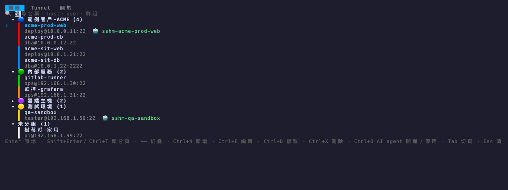
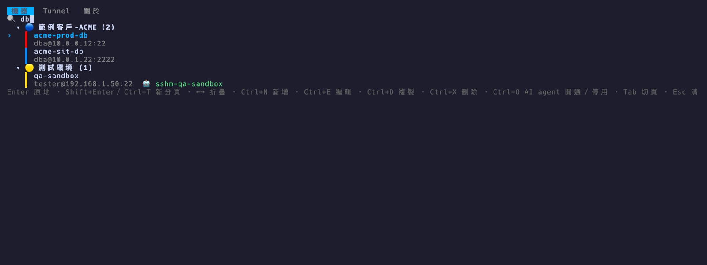
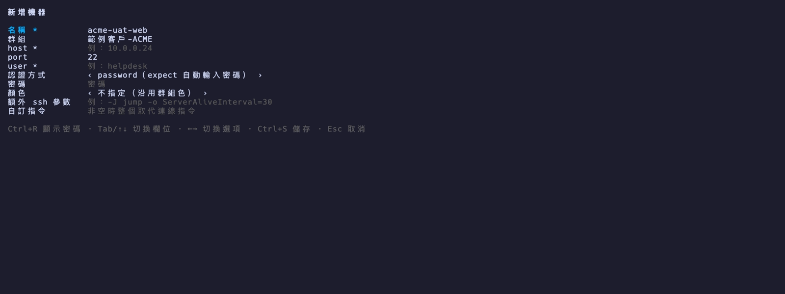
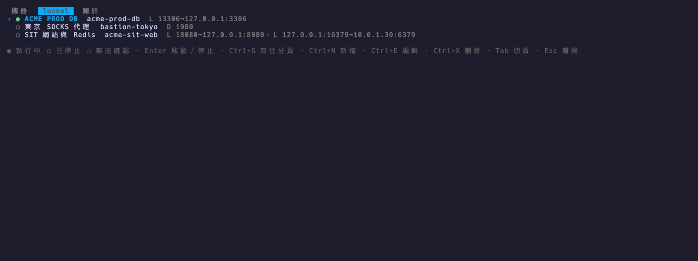
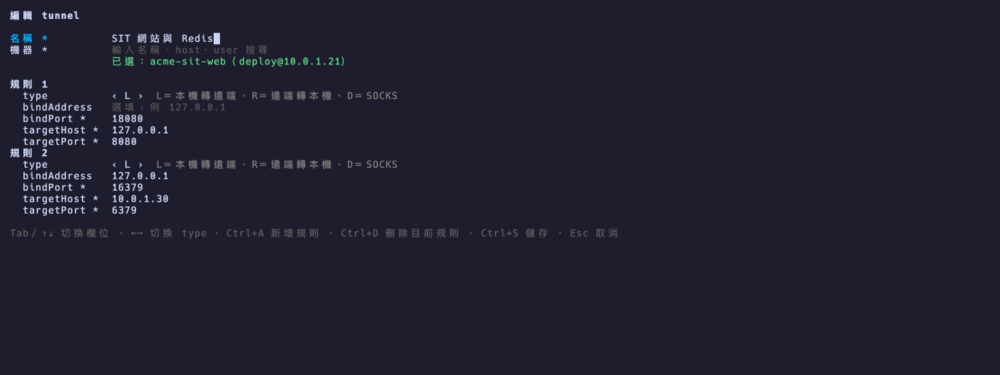
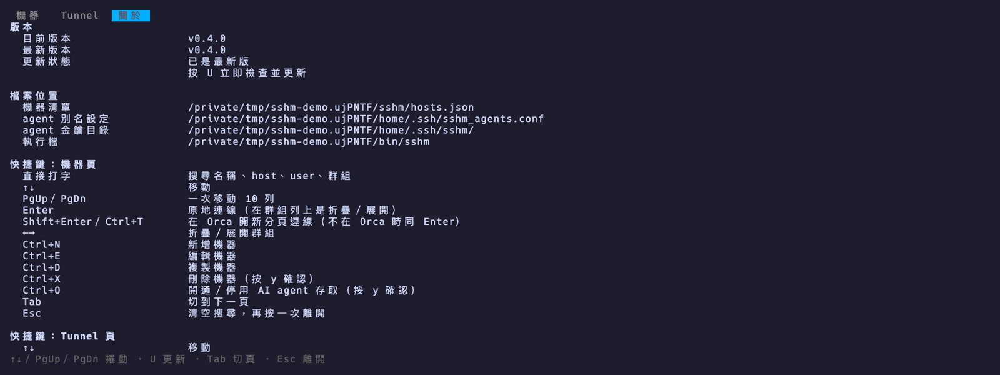
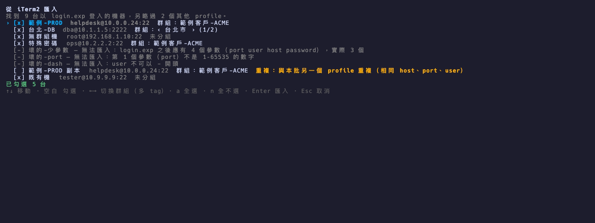
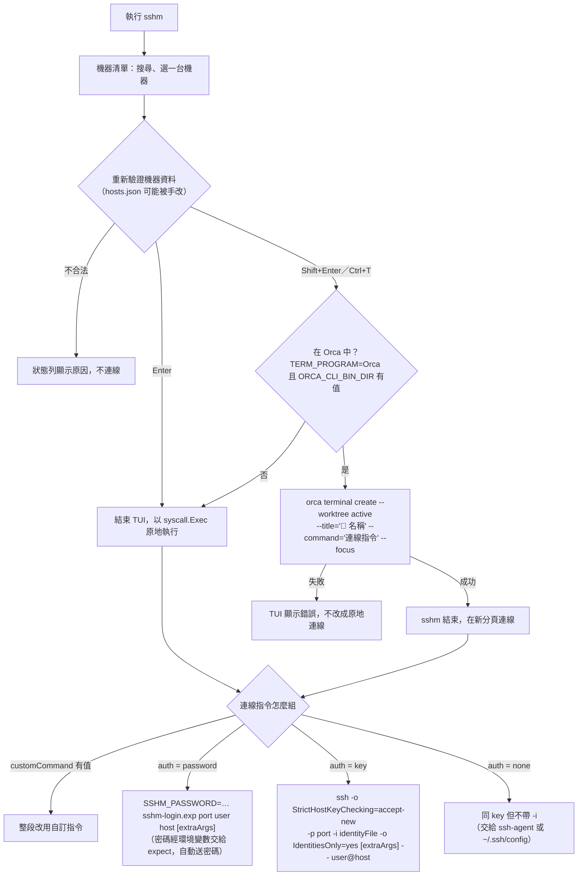
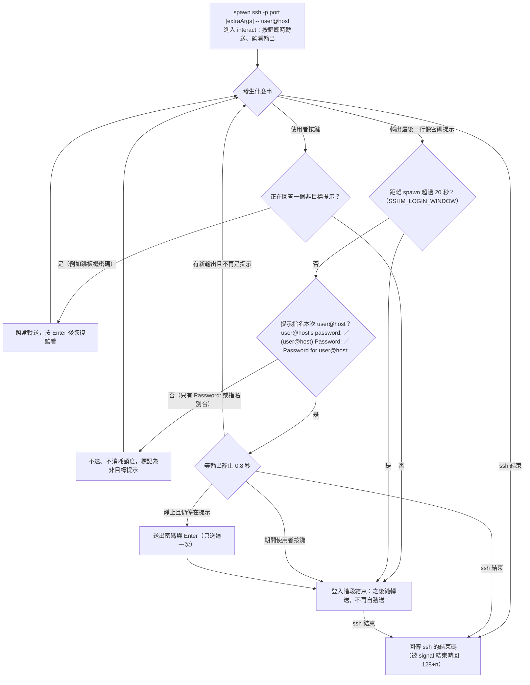
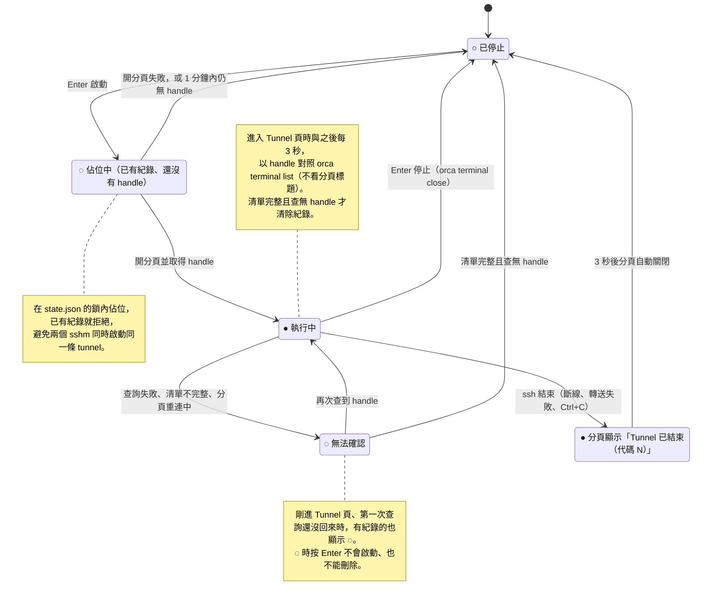

# sshm

macOS 上的 SSH 機器管理 TUI。按 Enter 在目前的 terminal 原地連線；在 Orca 裡按 Shift+Enter 會開新分頁連線。另外可以管理 SSH 轉送（Tunnel 頁）、把機器開通給 AI agent 用專用金鑰連線，並在「關於」頁一鍵更新到最新版。規格見 [docs/spec.md](docs/spec.md)，各版變更見 [CHANGELOG.md](CHANGELOG.md)。



> 本頁截圖全部使用虛構的展示資料，重製方式見 [docs/tapes/README.md](docs/tapes/README.md)。

## 安裝

需求：macOS（Apple Silicon 或 Intel）。密碼登入會用到 macOS 內建的 `/usr/bin/expect` 與 `ssh`，不用另外安裝。

```sh
# 1. 安裝（一行，自動判斷 Apple Silicon／Intel）
mkdir -p ~/.local/bin && curl -fsSL "https://github.com/mark22013333/sshm/releases/latest/download/sshm_darwin_$(uname -m | sed s/x86_64/amd64/).tar.gz" | tar xz -C ~/.local/bin sshm

# 2. 把安裝目錄加進 PATH，並讓行首帶空白的指令不進 history（sshm 送出的連線指令都帶空白）
echo 'export PATH="$HOME/.local/bin:$PATH"' >> ~/.zshrc
echo 'setopt HIST_IGNORE_SPACE' >> ~/.zshrc

# 3. （選用）在 zsh 提示列按 Ctrl+O 叫出 sshm
sshm zsh-widget >> ~/.zshrc

# 4. 重新載入
source ~/.zshrc
```

步驟 3 的 Ctrl+O 只在 **zsh 提示列**上作用（叫出 sshm）；進到 sshm 的機器清單後，Ctrl+O 是另一個功能：開通／停用選取機器的 AI agent 存取（會先列出要做的事，按 y 才執行）。

確認版本：`sshm --version`。升級可在 TUI 的「關於」頁按 U（見「關於頁與更新」），或重跑步驟 1。

> 請用上面的 `curl` 安裝。若改用瀏覽器下載壓縮檔，macOS 會因執行檔未經 Apple 簽章而擋下，需要先執行 `xattr -d com.apple.quarantine sshm`。

已安裝 Go 1.24 以上的話，也可以用 `go install github.com/mark22013333/sshm@latest`（裝到 `~/go/bin`）。

### 加入機器

三種方式擇一：

- `sshm add` 逐台新增。
- iTerm2 若是用 `login.exp <port> <user> <host> <password>` 登入，`sshm import-iterm` 一次匯入（見下方「從 iTerm2 匯入」）。
- 由別人匯出清單給你：對方執行 `sshm export sshm-share.json`（預設**不含密碼**），你執行 `sshm import sshm-share.json`，再於編輯畫面補上自己的密碼。分享清單時請不要加 `--with-passwords`，匯出檔中的密碼是明碼。

### 在 Orca 以外使用

Shift+Enter／Ctrl+T 開分頁連線與 Tunnel 的啟動、停止需要在 [Orca](https://github.com/stablyai/orca) 的 terminal 中執行。在 iTerm2 等其他終端機裡只能原地連線，Tunnel 頁為唯讀。

## 使用

```sh
sshm              # 開機器清單
sshm acme         # 開清單並預填搜尋字
sshm add          # 直接開「新增機器」表單
sshm -- add       # 搜尋字剛好跟子指令同名時，加 -- 當成搜尋字
```

開啟後游標就在搜尋框，直接打字即可過濾，比對名稱、host、user、群組（不分大小寫）：



機器清單的按鍵：

| 鍵 | 動作 |
|----|------|
| ↑↓ | 移動（PgUp／PgDn 一次 10 列） |
| Enter | 在目前的 terminal 原地連線 |
| Shift+Enter／Ctrl+T | 在 Orca 中開新分頁連線，不在 Orca 時改為原地連線（Orca 把 Shift+Enter 送成 ESC+Enter，等同 Alt+Enter；Cmd+Enter 不會送進 terminal，無效） |
| ←→ | 折疊／展開群組 |
| Ctrl+N／Ctrl+E／Ctrl+D／Ctrl+X | 新增／編輯／複製／刪除（刪除要按 y 確認；已開通給 AI agent 的要先停用） |
| Ctrl+O | 開通／停用選取機器的 AI agent 存取（見「給 AI agent 使用」，要按 y 確認）。和 zsh 提示列叫出 sshm 的 Ctrl+O 是不同功能 |
| Tab | 切到下一頁（「機器」→「Tunnel」→「關於」輪流） |
| Esc | 清空搜尋，再按一次離開 |

Ctrl+N 開「新增機器」表單（Ctrl+E 編輯也是同一個表單）。必填：名稱、host、user；認證方式與顏色用 ←→ 切換，認證方式為 password 時按 Ctrl+R 可切換顯示／隱藏密碼，Ctrl+S 儲存、Esc 取消：



資料存在 `~/.config/sshm/hosts.json`（有設 `XDG_CONFIG_HOME` 時改用該目錄），檔案權限 0600、目錄 0700。同時開多個 sshm 也不會互相覆蓋：每次存檔都會先鎖檔（`hosts.json.lock`）、重讀最新內容再寫回；編輯時只套用你改動的欄位，若那台已被另一個 sshm 刪除會顯示錯誤。hosts.json 可以是 symlink，sshm 會寫到連結目標。

## Tunnel 頁

按 Tab 切到「Tunnel」頁，管理 SSH 轉送（`-L`／`-R`／`-D`）。



| 鍵 | 動作 |
|----|------|
| ↑↓ | 移動 |
| Enter | 啟動／停止 |
| Ctrl+G | 前往分頁（讓 Orca 切到這條 tunnel 執行中的分頁） |
| Ctrl+N／Ctrl+E／Ctrl+X | 新增／編輯／刪除（刪除要按 y 確認；有執行紀錄的要先停止） |
| Tab | 切到「關於」頁 |
| Esc | 離開 |

- 每列顯示狀態燈（● 執行中、○ 已停止、◌ 無法確認）、名稱、機器名稱與規則摘要（例 `L 13306→127.0.0.1:3306`、`D 1080`）。
- 啟動會在 Orca 開一個專用分頁（標題 `⇄ <名稱>`，不搶焦點），指令是 `ssh -N -o ServerAliveInterval=30 -o ServerAliveCountMax=3 -o ExitOnForwardFailure=yes` 加上每條規則；密碼登入的機器一樣由 expect 腳本自動送密碼。分頁的 terminal handle 記在 `~/.config/sshm/state.json`（0600）。
- 狀態以 handle 對照 `orca terminal list` 判斷（不看分頁標題），進入 Tunnel 頁時與之後每 3 秒刷新一次；handle 已不存在就視為已停止並清掉紀錄。停止是 `orca terminal close`。不做自動重連。
- ◌（無法確認）出現在：第一次查詢還沒回來、Orca 沒回應、清單不完整（被截斷、有主機沒查到、有分頁正在重連）、或正在啟動中。◌ 時按 Enter 不會啟動，避免同一條 tunnel 開出兩個分頁；有執行紀錄（● 或 ◌，含不在 Orca 中）時也不能刪除。
- 兩個 sshm 同時按啟動時，只有先記錄的那個會開分頁，另一個會提示已有執行紀錄。
- ssh 結束（斷線、轉送失敗或按 Ctrl+C）時，分頁會顯示「Tunnel 已結束（代碼 N），3 秒後關閉此分頁」，3 秒後自動關閉，燈號隨之回到 ○。tunnel 不共用 ssh 的 ControlMaster 連線。
- 不在 Orca 中執行時 Tunnel 頁唯讀（不能啟動／停止），但仍可新增、編輯、刪除設定。
- 表單：名稱、機器（輸入文字搜尋、↑↓ 選擇、Enter 確定）、規則（type 用 ←→ 切換 L／R／D；bindAddress 選填；bindPort 必填；L／R 另需 targetHost、targetPort）。Ctrl+A 新增規則、Ctrl+D 刪除游標所在的規則、Ctrl+S 儲存。IPv6 位址直接填（例 `::1`），sshm 會自動加中括號。

  

- 刪除機器時，若有 tunnel 引用它，確認訊息會列出這些 tunnel；刪除後 tunnel 設定保留，但啟動時會顯示「機器已不存在」，請編輯改指另一台機器。這種 tunnel 在 `sshm export` 時不會匯出，結果會列出名稱。
- IPv6 位址可以不加中括號；要加的話必須成對（`[::1]`）。

## 關於頁與更新

在「Tunnel」頁再按一次 Tab 進入「關於」頁，內容超過畫面時用 ↑↓／PgUp／PgDn 捲動：



- **版本**：目前版本、GitHub 上的最新版本、能否自動更新；不能時附上手動指令。
- **檔案位置**：hosts.json、`~/.ssh/sshm_agents.conf`、`~/.ssh/sshm/` 金鑰目錄、執行檔（皆為解析 symlink 後的實際路徑）。
- **快捷鍵一覽**：機器頁、Tunnel 頁、機器表單、關於頁。
- **AI agent 用法摘要**與 GitHub 網址。

更新檢查與更新：

- sshm 啟動時在背景查 GitHub 的最新釋出版（不影響啟動速度），一天最多查一次，結果記在 `~/.config/sshm/update-check.json`。查詢失敗（例如離線）不會顯示任何訊息，也算當天查過。
- 有新版時，機器頁的狀態列會提示「有新版 vX.Y.Z，到「關於」按 U 更新」。
- 在「關於」頁按 **U**：下載這台 Mac 對應的 `sshm_darwin_<arm64|amd64>.tar.gz` 與 `checksums.txt`，SHA-256 相符才解出 `sshm`，寫到執行檔同目錄的暫存檔、沿用原權限後一次 rename 取代（透過 symlink 執行時取代的是連結目標）。完成後提示「已更新為 vX.Y.Z，請重開 sshm」。下載中斷、校驗不符或任何一步失敗，原執行檔都不會被改動。更新途中被強制結束而留在執行檔目錄的 `.sshm-update-<數字>` 暫存檔，會在下次啟動或下次更新時清掉（只清超過 10 分鐘、名稱相符的一般檔案）。
- 替換後的執行檔沿用原本的權限位元，但擁有者是執行更新的使用者。多人共用、群組可寫的安裝目錄裡，由別人更新後檔案擁有者會改變；在意的話請改用手動安裝。
- SHA-256 比對的界線：`checksums.txt` 與壓縮檔來自同一個 GitHub Release，比對只能確認下載過程沒有損壞或被截斷，**無法**防止 Release 本身或 GitHub 帳號被竄改（竄改者可以同時換掉兩者）。sshm 目前沒有簽章驗證，自動更新的可信度等同於這個 GitHub repo 的可信度。
- 只連 GitHub 官方網域（`api.github.com`、`github.com` 與 GitHub 的下載網域），每一次 redirect 都會檢查；下載有大小上限與逾時。
- 以下情況不自動更新，「關於」頁會改列手動做法：
  - 開發版（在原始碼目錄 `go build`／`go install` 得到的 `(devel)`、pseudo-version 等非正式版號）：用 `go install github.com/mark22013333/sshm@latest`。以 `go install …@latest` 安裝的版本號是正式版號，可以直接按 U 更新（會換成 GitHub 釋出版的執行檔）。
  - 執行檔所在目錄沒有寫入權限：列出對應目錄的 `curl … | tar xz -C <目錄> sshm` 指令，sshm 不會嘗試 sudo。
  - 不是 macOS（Apple Silicon／Intel）。

## 從 iTerm2 匯入

```sh
sshm import-iterm                       # 讀 ~/Library/Preferences/com.googlecode.iterm2.plist
sshm import-iterm --plist <路徑>        # 改讀指定的 plist
```



- 只處理 Initial Text 含 `login.exp` 的 profile：依 POSIX sh 規則拆分（與 iTerm2 把文字打進 shell 後的結果一致），`login.exp` 之後、`;` 等指令分隔符號之前的 4 個參數依序是 port、user、host、password。名稱取 profile 的 Name，群組取 Tags。
- 參數裡有會被 shell 展開的寫法（未加單引號的 `$`、反引號、`$'…'`、萬用字元、字首的 `~`）或引號未閉合時，標為「無法匯入」，請改成單引號後再匯入或手動新增。
- 先進預覽畫面：預設全選；已有相同 host＋port＋user 的標「重複」、預設不勾；參數數量不對、port 不是數字、user／host 以 `-` 開頭或含控制字元的標「無法匯入」並說明原因（不顯示密碼）。
- 預覽鍵位：↑↓ 移動、空白 勾選、←→ 切換群組（有多個 tag 時，預設第一個）、a 全選、n 全不選、Enter 匯入、Esc 取消。新群組會自動建立、不設顏色。
- 完成後顯示匯入幾台、略過幾台。讀取過程只透過 `plutil -extract "New Bookmarks"` 的輸出在記憶體中處理，不寫任何暫存檔。

## 給 AI agent 使用

讓別的 AI agent（Claude Code、Codex 等）能連進 VM 查東西，而且**正常使用時不需要、也不會接觸密碼**：sshm 用已存的密碼登入一次，替每台機器裝上一把專用金鑰並寫好 ssh 別名，之後 agent 只用 `ssh <別名>` 連線。

> **安全界線（請先讀）**：這個功能防的是 agent「誤開通」與「順手拿密碼來用」，**不是**防惡意繞過。agent 與 sshm 在同一個 OS 帳號下執行，技術上讀得到 `~/.config/sshm/hosts.json` 裡的明碼密碼與 `~/.ssh/sshm/` 的私鑰，也能用 expect／pty 之類的工具在終端機裡替你按 y。sshm 能保證的是：agent 照 `sshm agent guide` 的方式使用時，只需要 `ssh <別名>`，不需要也不會接觸密碼。要防惡意的 agent，得讓它跑在另一個 OS 帳號、容器或 VM 裡，讀不到你的家目錄。

```sh
sshm agent enable 範例客戶-PROD-VM          # 開通（列出要做的事，按 y 才執行）
sshm agent enable 範例客戶-PROD-VM --alias prod-vm --user readonly
sshm agent list                             # 已開通的機器：名稱、別名、host、user、群組
sshm agent list --json                      # 給 agent 讀的格式（不含密碼）
sshm agent disable 範例客戶-PROD-VM         # 停用（按 y 才執行）
sshm agent guide                            # 印出給 agent 指引檔的說明
```

在 TUI 的機器清單選一台按 **Ctrl+O** 也能開通，已開通的再按一次是停用；已開通的機器在 `user@host:port` 後面顯示 `🤖 別名`。

開通做的事（確認畫面會逐項列出，包括公鑰指紋與會寫入的檔案）：

1. 產生一把 ed25519 金鑰（無 passphrase）放在 `~/.ssh/sshm/<別名>`，目錄 0700、私鑰 0600。
2. 用 sshm 存的密碼登入（沿用連線用的 expect 腳本，只用密碼、只送一次），把公鑰加到遠端該帳號的 `~/.ssh/authorized_keys`：行首 `no-agent-forwarding,no-X11-forwarding`、行尾註解 `sshm-agent:<別名>`（註解只給人看）。sshm 以**公鑰本體**辨識自己那一行：重複開通不會產生重複行，別台電腦以相同別名開通的行、或你手寫同樣註解的行都不會被動到；寫入以暫存檔 rename 取代（不會因斷線留下半個檔）；同時確保 `~/.ssh` 0700、`authorized_keys` 0600。
3. 把別名寫進 sshm 自管的 `~/.ssh/sshm_agents.conf`（HostName、User、Port、IdentityFile、`IdentitiesOnly yes`、`IdentityAgent none`；新內容先寫暫存檔、用 `ssh -G` 解析過才取代舊檔），並在 `~/.ssh/config` **最上方**加一行 `Include ~/.ssh/sshm_agents.conf`（已有就不加；沒有 config 會建立，權限 0600）。若你的 config 裡這行位於某個 `Host`／`Match` 之後（含 `Host *`），sshm 只會警告，請自己把它移到最上方。
4. 以 `ssh -o BatchMode=yes -F ~/.ssh/config <別名> true` 實際連一次驗證。任何一步失敗都會復原（移除遠端公鑰、清掉別名與新產生的金鑰），並說明還有什麼殘留。

- 別名預設是 `sshm-` 加上機器名稱裡的英數（轉小寫，其他字元轉成 `-`），例：`範例客戶-PROD-VM` → `sshm-prod-vm`；名稱沒有英數時改用 host（`sshm-10-0-0-24`）；撞名時補 `-2`、`-3`。`--alias` 只能用小寫英數與 `. _ -`；你自己的 `~/.ssh/config` 已有同名 Host 時會拒絕。
- 登入帳號預設是 sshm 存的 user。`--user` 指定其他帳號時，會用**同一組密碼**嘗試登入那個帳號（只試一次，失敗就停止），確認畫面會特別註明。
- 只支援認證方式為 password、沒有自訂指令、沒有額外 ssh 參數的機器；其他會直接拒絕並說明原因。非 22 的 port 會寫進別名。
- host 必須是主機名稱（英數 `. _ -`）、IPv4 或不加中括號的 IPv6；登入帳號只能用英數與 `. _ -`（不以 `-` 開頭，結尾可有一個 `$`）。含引號、空白、`#`、`$`、`%`、反斜線等字元的機器不能開通——這些字元寫進 ssh 設定會讓**整份** `~/.ssh/config` 解析失敗。
- 在 sshm 改了已開通機器的 host／user／port（TUI 編輯或 `sshm import`），存檔時別名設定會跟著更新，並提示「需重新 enable，舊位置的公鑰會在 disable 時清除」；清單上的 `🤖 別名` 會標「位置已變更，需重新 enable」。改成上面不允許的字元時，只有這台的別名會停用（不寫進設定，其他機器照常），TUI 清單、匯入訊息與 `sshm agent list` 都會標出「別名已停用」與原因，改回合法值後自動恢復。
- 停用：用密碼登入每個裝過公鑰的位置（開通時記下的 host／port／user，以及目前位置）刪掉含這把公鑰的那一行，再移除別名區塊與金鑰。任一位置連不到時會列出是哪裡、遠端公鑰仍在，再問要不要只清本機。
- enable／disable 要在互動終端機按 y 確認：從管線、排程等非互動環境執行會直接拒絕，也沒有 `--yes` 之類跳過確認的選項。這道關卡只防**誤開通**（例如 agent 照著錯誤的指示執行），擋不住刻意用 pty 工具模擬按鍵的程式；見上面的「安全界線」。`list` 是唯讀的，不需確認。
- 開通狀態存在 hosts.json 該機器的 `agent` 欄位（本機狀態，匯出時不帶、匯入時忽略）。

給 agent 的指引（貼進 CLAUDE.md／AGENTS.md，`sshm agent guide` 會印出完整版）：

```text
先執行 sshm agent list --json 找機器，再用 ssh <alias> '<指令>' 連線。
連線不需要密碼；不要要求、搜尋或讀取密碼與私鑰。清單沒有的機器請使用者用 sshm 開通，不要自己執行 enable。
```

## 匯出／匯入 JSON

```sh
sshm export backup.json                     # 匯出（密碼清空）
sshm export --with-passwords backup.json    # 連密碼一起匯出，請妥善保管
sshm export --force backup.json             # 目的檔已存在時要加 --force 才覆蓋
sshm import backup.json                     # 匯入
```

- 格式與 hosts.json 相同，匯出檔權限 0600。目的檔是 symlink、或就是 sshm 的資料檔本身（含硬連結）時一律拒絕。
- 匯入時，新的機器、群組、Tunnel 直接加入；同 id（群組為同名）但內容不同的項目會先列出差異（密碼只顯示「密碼不同」），再選 y＝覆蓋、n＝只匯入新項目、其他＝取消。
- 匯入檔的密碼是空的（例如預設匯出的檔案）時：同一台的 host、port、user 都沒變才沿用現有密碼；任一有變就不沿用，差異清單會註明「密碼將沿用」或「密碼將清空」，匯入完成後列出需要補密碼的機器。
- 匯入檔裡只要有一項不合法（機器的 user／host 以 `-` 開頭或含控制字元、tunnel 規則不合法或指向不存在的機器、檔內 id 重複），整份都不匯入。未知欄位會原樣保留。
- 差異清單不顯示密碼、額外 ssh 參數、自訂指令的內容，只註明已變更。

## 密碼自動輸入的規則

密碼登入由內嵌的 expect 腳本處理，只在「登入階段」對「這次要連的機器」自動送一次密碼：

- 提示必須指名這次的 user 與 host（帳號大小寫要相符，主機名稱不分大小寫），支援 OpenSSH 的三種格式：`user@host's password:`、`(user@host) Password:`、`Password for user@host:`（不分大小寫，後面可接空白或色碼）。只有 `Password:` 而沒有 user@host 的提示一律不送。
- 跳板機（ProxyJump／ProxyCommand）的提示指名的是跳板機，不會送出；請自己輸入跳板機密碼，之後目標機的提示仍會自動送。
- 連線後 20 秒內、你還沒自己打字之前才會送。提示出現後要等輸出靜止 0.8 秒、確認仍停在提示上才送，這段期間你一按鍵就不送。
- 送過一次、超過 20 秒、或你已經開始自己打字之後，就不再比對，所以 `su`、`sudo`、`mysql -p`、從遠端再 ssh 到第三台時的密碼提示都不會被自動填入。密碼錯誤時的第二次提示也不會重送。
- 若 `~/.ssh/config` 用 `HostName` 改寫了主機名稱，提示上顯示的 host 會和 sshm 裡填的不同，這時不會自動送，請手動輸入（或把 sshm 的 host 改成提示上顯示的名稱）。

## 運作方式

### 連線流程

選好機器後，Enter 一律原地連線；Shift+Enter／Ctrl+T 只有在 Orca 中才開新分頁。實際執行的指令依認證方式而定。



### 自動送密碼的判斷（expect 腳本）

`assets/sshm-login.exp` 只在登入階段、對這次要連的機器送一次密碼，細節見上一節「密碼自動輸入的規則」。



### Tunnel 的狀態

燈號由 `state.json` 的紀錄加上 `orca terminal list` 的查詢結果決定。



## 已知限制

- **金鑰已登入後仍可能送出密碼（機率極低）**：若已用金鑰登入，而遠端在登入時窗（20 秒）內、你按任何鍵之前，印出指名本次 user@host 的密碼提示，sshm 仍會送出密碼。
- **密碼以明碼保存**：存在 hosts.json 裡。連線時經環境變數 `SSHM_PASSWORD` 交給 expect 腳本（讀完即清除，ssh 與遠端拿不到），不出現在行程參數中；但 expect 行程自己的初始環境在連線期間仍含密碼，同一使用者或 root 讀得到。在 Orca 開新分頁時，`orca terminal create --command=…` 行程存活的短暫期間，其參數仍含密碼。
- **在 Orca 開新分頁時，密碼會出現在畫面上**：連線指令（含密碼）是打進新分頁 shell 的文字，會顯示在新分頁畫面與 scrollback 裡。
- **沒開 zsh 的 `HIST_IGNORE_SPACE` 時，連線指令（含密碼）會寫進 shell history**；分頁若是 bash，要另外設定 `HISTCONTROL=ignorespace`。
- **Orca 可能把 scrollback 存到磁碟**（依 Orca 原始碼推論，未實測），密碼可能因此留在磁碟上。
- **密碼不能含 emoji 等非 BMP 字元**：macOS 內建的 expect 是 Tcl 8.5，非 BMP 字元送出時會被重複編碼，導致密碼錯誤。中文等 BMP 字元正常。
- **AI agent 的金鑰沒有 passphrase**：任何能讀 `~/.ssh/sshm/` 的程式都能用它登入已開通的機器，請只開通需要的機器，用完就停用。
- **新分頁的 shell 要是 POSIX 相容的 shell（zsh、bash、sh）**：連線指令用 POSIX 單引號規則跳脫。fish 對單引號內的 `\` 有不同解讀，密碼或參數含 `\`、`'` 時可能出錯。

## 版本紀錄

各版新增與修正的重點整理在 [CHANGELOG.md](CHANGELOG.md)。

## 發版（維護者）

推送 `v*` tag 會觸發 GitHub Actions：在 macOS runner 跑 `go vet`、`go test`，再由 [GoReleaser](https://goreleaser.com) 建立 GitHub Release，上傳 `sshm_darwin_arm64.tar.gz`、`sshm_darwin_amd64.tar.gz` 與 `checksums.txt`（設定在 `.goreleaser.yaml`、`.github/workflows/release.yml`）。

```sh
goreleaser release --snapshot --clean   # 發版前先在本機試打包，產物在 dist/
git tag -a v0.2.0 -m "v0.2.0"
git push origin v0.2.0
```

